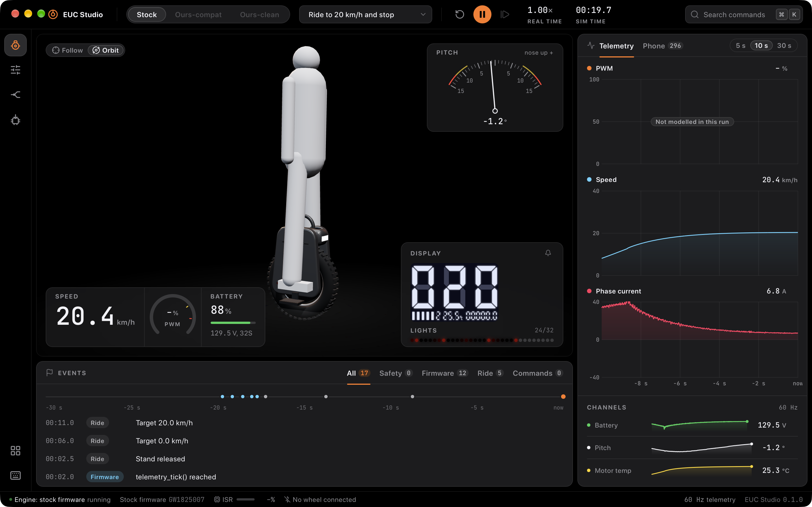

# EUC Studio (app)

The desktop studio: Tauri 2, React 19, Vite, TypeScript, Tailwind 4, Motion, react-three-fiber
and uPlot. In the desktop window the studio runs the real engine: the stock Begode Extreme
firmware on an emulated STM32F1, its electrical plant and a MuJoCo body with a rider, riding the
repository's `scenarios/*.toml` and streamed to the UI from a simulation thread. In a plain
browser and in tests it runs a deterministic synthetic demo engine instead. The status bar always
names the engine.



The real engine in `pnpm tauri dev`: the stock firmware at 20.4 km/h in `ride-20kmh-stop`, its
display replica showing `020`, the light strip from the WS2812 buffer. The browser build's demo
engine looks like [this](docs/screenshots/ride.png).

## Run

Needs Node 20.19+ (22 in CI), pnpm 10 and, for the desktop shell, stable Rust plus the
[Tauri prerequisites](https://v2.tauri.app/start/prerequisites/).

```sh
pnpm install
pnpm dev            # web build at http://localhost:1420 (no Tauri), demo engine
pnpm tauri dev      # desktop window, real engine
pnpm tauri build    # bundles for this OS
```

The real engine needs two things once per machine, from the repository root:

```sh
python3 tools/fetch-mujoco/fetch.py          # MuJoCo, the physics library the engine links
cargo run -p euc-cli -- fetch begode-extreme # the stock image, from Begode's update server
```

If the image is not in the firmware cache, the app fetches it on start. `pnpm tauri dev` builds the
backend with the `unicorn` feature (the CPU emulator, GPL-2.0). That feature is for development
only: a bundle build refuses to compile with it, and CI checks that. Set `EUC_NO_UNICORN=1` to
build without it (the engine then reports that no CPU backend is present). Add `?engine=demo` to
the URL to force the demo engine in the desktop window.

`EUC_STUDIO_PERF=20 pnpm tauri dev` measures frame times for 20 s after a warm-up, then again
every 10 s, and prints them to the terminal (`PERF ...`). The window must stay in front: a covered
window gets few frames, and its lines show that in the frame count.
`EUC_STUDIO_CONTROL=<file>` (dev builds) runs each line written to that file as a command:
`restart [scenario]`, `play`, `pause`, `rtf <x>`, `send <command id> [value]`, `eval <js>`.

In the window:

- The run bar lists every scenario in the repository's `scenarios/` folder.
- The wheel is the scanned Begode Extreme from `public/models/begode-extreme/` when the files are
  there (level of detail 1, or 2 without a GPU), else a stylized model.
- The Display card shows the replica of the wheel's display board and its tail light. The bell
  plays the firmware's buzzer through the speakers (off by default; ⌘K "Toggle buzzer sound").

## Check

```sh
pnpm typecheck && pnpm lint && pnpm format:check
pnpm tokens:check   # src/design/tokens.css matches tokens.ts
pnpm contrast       # every declared text/surface pair passes WCAG AA
pnpm test           # Vitest: ring buffer, demo engine, tokens, digits, keys, palette matching
pnpm e2e            # Playwright: builds, serves, screenshots every workspace and the gallery
cargo test --manifest-path src-tauri/Cargo.toml                    # backend: phone decoder, runner
cargo test --manifest-path src-tauri/Cargo.toml --features unicorn \
  -- --ignored --nocapture                                          # stock firmware boots, rides the scenario
```

Screenshots land in `test-results/screens/`. `DOCS_SCREENSHOTS=1 pnpm e2e` also refreshes the
curated ones in `docs/screenshots/`.

## Layout

| Path                    | What                                                                            |
| ----------------------- | ------------------------------------------------------------------------------- |
| `src/design/tokens.ts`  | The only hand-written design token file                                         |
| `src/design/tokens.css` | Generated by `pnpm tokens` (do not edit)                                        |
| `src/ui/`               | Component library; every component in every state at `#/gallery`                |
| `src/shell/`            | Run bar, rail, docks, status bar, commands and hotkeys                          |
| `src/workspaces/`       | Ride (3D viewport, telemetry, events) and the Tune, Compare, Flash placeholders |
| `src/engine/`           | `EngineClient` interface, live engine client, batch decoder, engine selection   |
| `src/sim/`              | Demo engine (browser and tests)                                                 |
| `src-tauri/`            | Desktop shell (its own cargo workspace)                                         |
| `src-tauri/src/engine/` | Simulation thread, host over the emulated board, phone decoder, commands        |

Design system, motion rules and the decisions log: [DESIGN.md](DESIGN.md). Licenses:
[THIRD_PARTY.md](THIRD_PARTY.md).
